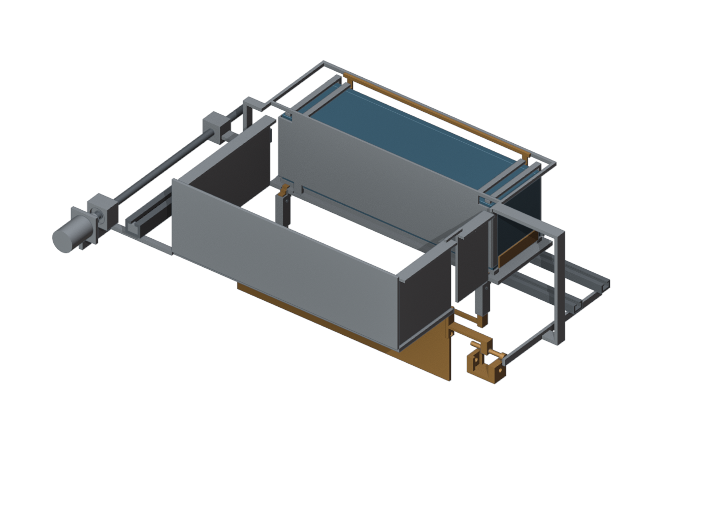

# VOLLEY Labs

### Mechanism research, alternative architectures and numerical experiments

This repository preserves the alternative mechanisms and exploratory calculations behind VOLLEY. Each study records its configuration, method, findings and conditions for further development. Research candidates enter the engineering baseline only after the applicable design gates are satisfied.

[Feeder concept comparison](docs/GEN6_FEEDER_CONCEPT_TRADE.md) · [Current native evidence](experiments/feeder-integrity-review/README.md) · [Matched mission study](experiments/finite-burn-review/README.md)

## Study configuration

**Gen5** is the fixed evaluated configuration: twelve 4 kg 3U payloads, a 1.3 m powered stroke and a reusable carrier. Its technical evidence snapshot is retained with the assessed design criteria. **Gen6** is a separate development study for passive 1U and 3U spacecraft, initially two of each, with a twelve-payload expansion assessed separately.

The Gen6 mission reference uses a generic maneuvering OTV in approximately 500 km sun-synchronous orbit. Four releases occur within one orbital period; full position and velocity targets are evaluated at a common epoch 24 hours after the last release. Host maneuvers and their resource costs are included for both deployment policies. These are declared surrogates, not provider-approved interfaces.

## Engineering evidence

*FM06-R1 nominal transfer configuration. Editable geometry, STEP exchanges, calculations and native solver records are included in the [engineering package](experiments/feeder-integrity-review/README.md).*

| Evidence | Published result | Interpretation |
|:--|:--|:--|
| Native geometry | 30 assembly poses and 70 individual STEP exchanges | Nominal, prescribed-motion geometry checks |
| Current receiver fixtures | 12 native finite-element analyses | 0.05998 mm mean loaded-face displacement for the 3U one-dog 1000 N ideal fixture |
| Transfer tine | Four native unit-load meshes | 0.010145 mm/N finest-mesh mean compliance under the stated clamp and material assumptions |
| Orbital campaign | 18 targeted schedules and 46 native Orekit replays | Matched finite-force host-control and resource comparisons |

[Native FreeCAD](experiments/feeder-integrity-review/cad/FM06_3U_transfer.FCStd) · [Assembly STEP](experiments/feeder-integrity-review/cad/FM06_3U_transfer.step) · [Part index](experiments/feeder-integrity-review/parts/INDEX.json) · [Load/contact report](experiments/feeder-integrity-review/FEEDER_INTEGRITY_REVIEW.pdf)

## Matched orbital delivery

The finite-burn study compares the same constructed terminal states and resource boundary. Under the declared twelve-release 35%/35% policy, the spring input requires 33.83 N peak and 23.12 kg propellant; the imposed VOLLEY release input requires 18.00 N and 6.12 kg. With a common 100 N limit and 30 kg propellant allowance, both policies reach the constructed translational targets. The assumed VOLLEY device-mass premium exceeds its propellant saving in this comparison.

[Method, inputs and native outputs](experiments/finite-burn-review/README.md) · [Engineering report](experiments/finite-burn-review/FINITE_BURN_CAMPAIGN_REVIEW.pdf) · [Native replay and command sensitivity](experiments/native-campaign-review/README.md)

## Evidence boundaries

This is a computational design study. No physical prototype, measured release performance or flight qualification is claimed. Fixture compliance uses idealized supports and material assumptions. The current [FCE12 contact study](experiments/feeder-contact-verification/README.md) calibrates the numerical representation against analytical controls and full-solid poses. Final-state sensitivity remains an acceptance requirement. Installed actuation, complete release/reset and mixed-size system integration remain development requirements. All seven feeder architectures remain unselected.

## Research and development

The [feeder trade](docs/GEN6_FEEDER_CONCEPT_TRADE.md) compares lead-screw, escapement, rack/pawl, indexed tray/drum, pantograph, telescoping and belt/cable approaches. Safety, retention, integration, mass, motion and fault evidence govern downselection. A 1 km/s-class release is a separate long-range scaling objective.

The gas-guide and independent-cell branches are preserved as historical alternatives. Their assumptions do not define the current Gen5 study or a selected Gen6 mechanism. The local experiments retain input versions and numerical outcomes for comparison.

## Reproducibility

Captured studies include source inputs, solver versions, raw outputs, figures and hash manifests. Their local README files specify the required software and replay commands. Native CAD requires FreeCAD; STEP provides the neutral geometry exchange. Blender assets are identified as renders.

Run `python tools/prepublish_gate.py --all` for publication checks. Reproduce each experiment using its local instructions and recorded toolchain.

## Project editions

[VOLLEY](https://github.com/aaaaaaaaaaaavm/VOLLEY) · [Thesis](https://github.com/aaaaaaaaaaaavm/VOLLEY-thesis) · [Paper](https://github.com/aaaaaaaaaaaavm/VOLLEY-paper) · [Labs](https://github.com/aaaaaaaaaaaavm/VOLLEY-lab)

Each edition contains its own evidence and documentation. Historical work remains traceable through dated studies and Git history.

## Contact-model verification

[FCE12 method, native outputs and calibration](experiments/feeder-contact-verification/README.md) evaluates the FM06 transfer geometry with exact material partitions. Fourteen planar controls and 84 full-solid pose checks establish the stated numerical resolution; final-pose and impulsive-force refinement remain separate acceptance criteria.
