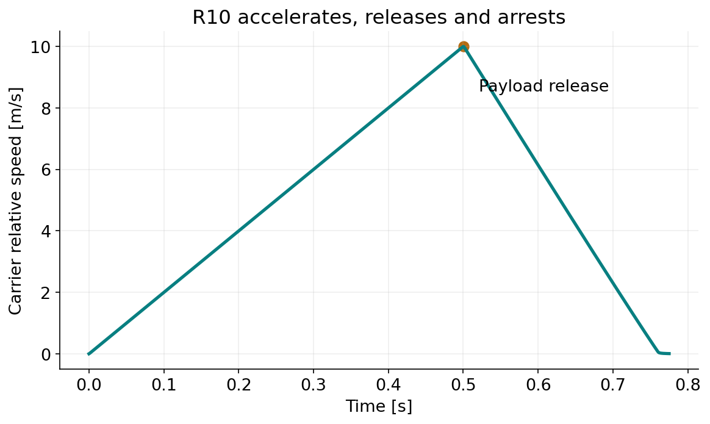
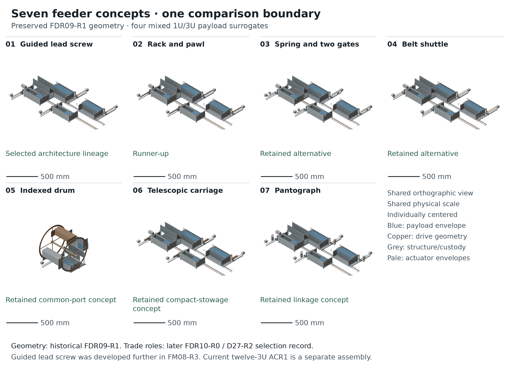

# VOLLEY Labs
### Mechanism research, higher-speed launchers and orbital delivery

VOLLEY Labs develops and preserves the engineering experiments behind commanded CubeSat deployment: feeder mechanisms, finite electromagnetic models, source-coupled launchers and mission architecture studies. Each experiment has its own configuration, inputs, results and reproduction route.

[10 m/s design study](experiments/ten-metre-per-second-design/README.md) · [Current-setup speed envelope](experiments/speed-envelope-extension/README.md) · [Feeder trade](experiments/selected_feeder/verification/REPORT.md) · [Lunar delivery](experiments/lunar-delivery-design-space/README.md)

<p><a href="figures/acr1-polish/assembly_hero.png"></a></p>

*CAD-derived Blender render · Gen5 ACR1 academic reference. [Source and render provenance](figures/acr1-polish/POLISH_PROVENANCE.json). Research configurations below retain their separate identities.*

## Higher-speed launcher research

| Experiment | Question and result |
|:--|:--|
| **[R10 / F10: new 10 m/s configurations](experiments/ten-metre-per-second-design/README.md)** | New finite winding/magnet maps, source and installed-mass accounting. R10 passes its declared nominal/adverse circuit/motion cases; the attached-shoe F10 adverse case misses the speed tolerance. |
| **[Unchanged-configuration speed envelope](experiments/speed-envelope-extension/README.md)** | 106 records, including 88 new computations and 17 timestep refinements. Common sampled upper command points are 4.60 m/s nominal and 3.70 m/s adverse across three inductances. |
| **[Published experimental benchmark](experiments/published-force-benchmark/README.md)** | Traceable reconstruction of a measured force/current observable, with separate calibration and held-out comparisons. |
| **[Earth-to-lunar-orbit delivery](experiments/lunar-delivery-design-space/README.md)** | Departure, host recoil and lunar capture treated separately; analytical bounds plus an ideal numerical five-day transfer and post-capture coast. |

<p><a href="experiments/ten-metre-per-second-design/R10_VELOCITY.svg"></a></p>

*Computed result · R10-R1. The study supplies finite field, winding, source, energy, mass and one-shot thermal calculations. It is a new computational design, separate from the Gen5 1–3 m/s academic reference.*

## Feeder architectures

The selected guided lead-screw principle provides controlled transfer through a restrained channel into a defined receiver. The trade preserves all seven candidates, their common-boundary CAD, quantitative sizing and failure mechanisms.



*CAD-derived Blender comparison · FDR09-R1 geometry. Selection follows the separately identified later FM08 / FDR10 trade.*

| Rank | Architecture | Weighted judgment / 10 | Engineering role |
|---:|:--|---:|:--|
| 1 | Guided lead screw | 7.30 | Selected transfer principle; guided pusher and positive receiving stops |
| 2 | Rack and pawl | 7.10 | Runner-up; backlash, tooth support and engagement require control |
| 3 | Spring and two gates | 6.90 | Low-active-power alternative; governed motion and reset are decisive |
| 4 | Belt shuttle | 6.70 | Flexible packaging; tension and skipped engagement drive the comparison |
| 5 | Indexed drum | 6.40 | Common-port storage; indexing and shared-path isolation drive integration |
| 6 | Telescopic | 6.05 | Compact stowage; stage overlap, alignment and binding govern performance |
| 7 | Pantograph | 5.50 | Collapsible storage; near-flat linkage loads and joint play govern sizing |

Weights: safety 35%, packaging/mass 25%, positioning 20%, cycle/power 10%, manufacture 10%. Scores are declared engineering judgments, not measured reliability; the sensitivity study records ranking changes.

[Selection report](experiments/selected_feeder/verification/REPORT.md) · [Seven native CAD/STEP concepts](experiments/feeder_common_boundary/README.md) · [Concept cards](figures/feeder-concepts/README.md) · [Interactive gallery](docs/feeder-concepts.html)

## Complete research catalogue

Recent results above are highlights. The catalogue below retains earlier investigations, rejected concepts, intermediate mechanism revisions and their source records. Each package retains its own configuration and outcome.

### Foundational architecture alternatives

| Investigation | Engineering question / retained disposition |
|:--|:--|
| [Free-flying host — PII-8](archive/concepts/PII-8_free_flyer.md) | Dedicated spacecraft versus shared-host accommodation, including propulsion and service burden |
| [Lunar mass driver — PII-9](archive/concepts/PII-9_lunar.md) | Launch from a lunar surface; a distinct architecture from Earth-orbit satellite separation |
| [Deployable track — PII-11](archive/concepts/PII-11_deployable_track.md) | Longer stowable stroke, deployment geometry and straightness |
| [Cable-driven gondola — PII-14](archive/concepts/PII-14_cable_driven_gondola.md) | Lower moving magnetic mass versus rotating drivetrain inertia and pulse-source burden |
| [Induction-drive study — PII-19](archive/concepts/PII-19_induction_drive_legacy_study.md) | An alternative drive architecture retained after its original selection was superseded |
| [Water and steam — PII-21](archive/concepts/PII-21_water_working_fluids.md) | Working-fluid savings versus guide-tube temperature and structural mass |
| [Independent release cells — X003](archive/concepts/VLAB-X003_independent_cell_bank.md) | Motor-charged individual release accumulators; withdrawn from the VOLLEY reference and retained as a comparator |
| [Widened feeder route — X004](archive/concepts/VLAB-X004_feeder_candidate_r1.md) | Early side-transfer and central-lift packaging candidate |
| [Segmented energization — X005](archive/concepts/VLAB-X005_segmented_stator_hypothesis.md) | Conditional copper/loss savings and the requirements for an actual segmented drive |

### Feeder, custody and release investigations

| Package | Contents |
|:--|:--|
| [Initial feeder review](experiments/feeder-design-review/README.md) | Seven single-cell concepts, native CAD/STEP, load screens and fault requirements |
| [Common four-cell boundary](experiments/feeder_common_boundary/README.md) | Seven mechanisms on a common packaging and represented-mass basis |
| [Selected feeder](experiments/selected_feeder/README.md) | FM08 guided lead-screw subsystem, detailed sizing, comparison and selection |
| [Actuation](experiments/feeder-actuation-review/README.md) | Drive requirements, actuator sizing and retained earlier variants |
| [Integrity review](experiments/feeder-integrity-review/README.md) | Mechanical integration and correction evidence, including retained rejected variants |
| [Captive transfer](experiments/captive-transfer-review/README.md) | Fork/receiver custody, nominal swept geometry and arrest/contact coupons |
| [Release and reset](experiments/feeder-release-review/README.md) | Receiver locking, exit-gate motion and prescribed reset geometry |
| [Rotary clearance](experiments/feeder_rotary_clearance/README.md) | Restricted gate-relief and rotational interval checks |
| [Contact verification](experiments/feeder-contact-verification/README.md) | Earlier contact models, solver captures and numerical comparisons |
| [Contact diagnosis](experiments/feeder_contact_diagnosis/README.md) | Timestep and representation sensitivity of the earlier contact model |
| [Replenishment](experiments/replenishment-feasibility/README.md) | Storage-to-carrier feeding, cycle integration and feasibility requirements |

### Missions and system architecture

| Package | Contents |
|:--|:--|
| [Coupled delivery](experiments/coupled-delivery-review/README.md) | Changing host mass, release and reserve-sensitive delivery campaigns |
| [Native campaign review](experiments/native-campaign-review/README.md) | Native trajectory replay and matching of mission assumptions |
| [Finite-burn campaigns](experiments/finite-burn-review/README.md) | Host-assisted spring and commanded-release alternatives with finite-force host operations |
| [System feasibility](experiments/system_feasibility_closure/README.md) | Four/twelve-payload integration and installed-resource accounting |
| [Extended feasibility bounds](experiments/extended_feasibility_bounds/README.md) | Conservation, high-speed scaling and incompatibility screens |
| [Native lunar coast](experiments/lunar_native_coast/README.md) | Earlier numerical transfer/coast cases and retained duration interpretations |
| [Lunar delivery design space](experiments/lunar-delivery-design-space/README.md) | Departure, recoil, explicit capture and ideal numerical lunar-orbit delivery |

### Electromagnetic drive and experimental comparison

| Package | Contents |
|:--|:--|
| [Higher-speed constraint screen](experiments/higher-speed-envelope/README.md) | Unchanged-model 10–100 m/s requests, electrical/arrest constraints and attached-shoe trade |
| [Sampled speed envelope](experiments/speed-envelope-extension/README.md) | Refined current-setup command brackets and architecture requirements |
| [New 10 m/s designs](experiments/ten-metre-per-second-design/README.md) | R10 reusable carrier and F10 attached shoe; actual finite fields and coupled cases |
| [Published force/current comparison](experiments/published-force-benchmark/README.md) | Digitized experimental observable, held-out checks and reconstruction uncertainty |

### Earlier reference studies and research records

[Mission and first-article requirements](docs/GEN6_G0_MISSION_AND_ARTICLE_REQUIREMENTS.md) · [Public reference audit](docs/GEN6_GO1_PUBLIC_REFERENCE_AUDIT.md) · [Two early FreeCAD/STEP article envelopes](cad/gen6_first_article/README.md) · [Power and metrology screen](analysis/results/gen6_go2_power_instrument_screen.json) · [Mixed-manifest mission](analysis/results/gen6_mixed_mission.json) · [Precision-delivery design space](analysis/results/precision_delivery_design_space.json) · [Feeder load screen](docs/GEN6_FEEDER_LOAD_SCREEN.md) · [Market and spacecraft fit](MARKET_AND_CUSTOMER_FIT.md)

<details>
<summary>Transferred historical investigations</summary>

These records preserve the original research routing. They sit outside current VOLLEY requirements and supply no inherited validation to the selected machine.

| Record | Archive |
|:--|:--|
| B001 | [Relaxed cooperative-interface architecture](archive/concepts/VLAB-B001_bolley_unbound.md) |
| B002 | [Active cooperative interface](archive/concepts/VLAB-B002_active_cooperative_interface.md) |
| B003 | [Distributed feed architecture](archive/concepts/VLAB-B003_distributed_fluxpiston_feed.md) |
| X001 | [Quadrant gas-bearing concept](archive/concepts/VLAB-X001_quadrant_gas_bearing.md) · [Original input declaration](experiments/VLAB-X001/RUN_SHEET.md) |
| X002 | [Passive trim secondary](archive/concepts/VLAB-X002_passive_trim_secondary.md) |

[Project boundary](docs/PROJECT_BOUNDARY.md) · [Historical routing ledger](archive/concepts/TRANSFER_LEDGER.md) · [Original branch register](archive/concepts/BOLLEY_BRANCH_REGISTER.md)

</details>

[Archive index](archive/README.md) · [Repository map](docs/REPOSITORY_MAP.md) · [Dated notes](notes/README.md) · [Configuration guide](docs/CURRENT_CONFIGURATION.md)

## Inspect and reproduce

Follow each experiment's README for exact inputs, dependencies and commands. Captured packages include source identities, numerical outputs and hash manifests. Native CAD uses FreeCAD/STEP; render captions identify visualization and provenance. Computational criteria and physical tests remain distinct evidence stages.

```bash
python3 tools/prepublish_gate.py --all
```

[Integrated VOLLEY study](https://github.com/aaaaaaaaaaaavm/VOLLEY) · [Academic report](https://github.com/aaaaaaaaaaaavm/VOLLEY-thesis) · [Research manuscript](https://github.com/aaaaaaaaaaaavm/VOLLEY-paper) · [Scientific figure conventions](docs/FIGURE_STANDARD.md) · [Citation](CITATION.cff) · [Licensing](LICENSE)
