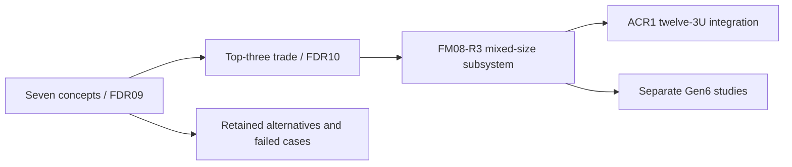

# Current configuration and experiment map

**Source/result cutoff: 25 October 2026. Current integrated reference: VOLLEY-G5-ACR1.** Labs preserves the alternatives and evidence that explain the design decision. The [main ACR1 package](https://github.com/aaaaaaaaaaaavm/VOLLEY/tree/main/validation/acr1) holds the current integrated scientific source, inputs, outputs and reproduction instructions.

## What changed

ACR1 retains twelve nominal 4 kg 3U rectangular surrogates. Two fixed six-level banks feed through guided lead-screw pushers to a restrained, vertically indexed cradle. Positive capture transfers the captive pallet to the reusable launch sled; the cradle withdraws before launch. The pallet remains on the carrier during arrest and return.

Eight frozen native/STEP states and 154 accepted installed-motion/refinement checks establish the declared nominal geometry boundary. The supported modeled operating range is 1–3 m/s; 3 m/s is the principal case. Current mass is 149.55672 kg CAD dry plus a 7 kg electrical/control allowance, giving 156.55672 kg device mass. The allowance is not a measured or spatially complete installed electronics package. No hardware, measured performance, qualification or provider acceptance is claimed.

## How the retained experiments relate

| Configuration / package | What the reader can infer |
|---|---|
| [FDR10/FM08-R3](../experiments/selected_feeder/README.md) | Seven-way trade, top-three common assumptions, guided lead-screw selection, mixed two-1U/two-3U subsystem CAD and checks |
| [FDR09 common boundary](../experiments/feeder_common_boundary/README.md) | All seven CAD concepts and their original packaging/geometry findings |
| [Original feeder trade](GEN6_FEEDER_CONCEPT_TRADE.md) | Dated rationale and sensitivity of the declared judgment scores |
| [FM07 release/reset](../experiments/feeder-release-review/README.md) | Earlier receiver/exit-gate nominal poses; not a test of ACR1 |
| [Contact diagnosis](../experiments/feeder_contact_diagnosis/README.md) | Failed convergence/representation limits; no accepted precision or force rating |
| [Finite-force mission study](../experiments/finite-burn-review/README.md) | Its matched host-assisted comparison and input-specific conclusion |
| [Pre-ACR1 integration study](../experiments/system_feasibility_closure/README.md) | Earlier four/twelve resource and feasibility accounting; no automatic transfer to ACR1 |
| [Lunar/high-speed bounds](../experiments/extended_feasibility_bounds/README.md) | Separately sourced conservation and incompatibility screens |

The selected guided lead-screw principle carries forward. FM08's four-cell mixed manifest, belt-indexed receiver and original geometry are not relabeled ACR1. Original Gen5 16.029 m/s and 12.448 m/s results, old mass estimates and fit failures remain historical results. They neither rate nor invalidate a different configuration without the corresponding source-dependent check.

This diagram records design lineage, not shared validation. Reproduce each package on its declared toolchain and compare hashes before interpreting its claims. The earlier unconverged contact model supplies no ACR1 precision or design-load rating.

[Main engineering record](https://github.com/aaaaaaaaaaaavm/VOLLEY) · [Labs overview](../README.md) · [Thesis](https://github.com/aaaaaaaaaaaavm/VOLLEY-thesis) · [Paper](https://github.com/aaaaaaaaaaaavm/VOLLEY-paper)
