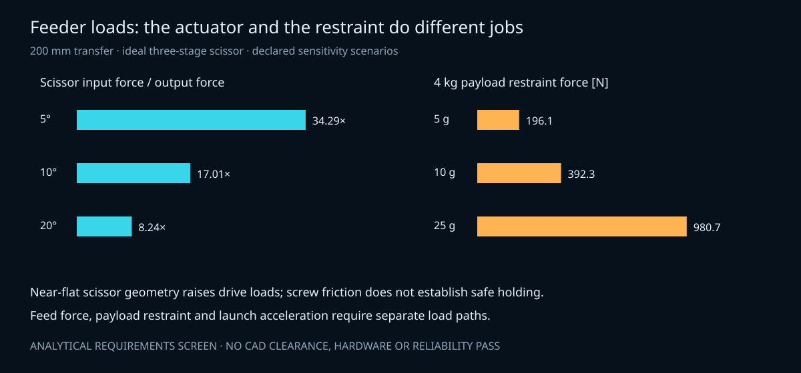

# Gen6 feeder: comparable load and energy screen

**Analytical sensitivity study; no selected mechanism, rated component or verified CAD.**

The reference is a 200 mm lateral one-way feed. The 1.33/4 kg cases match the mixed-size mission surrogates; 6 kg is a sensitivity only. Duration is active transfer time, not total deployment cadence. The three architectures share payload, travel, duration and opposing-force scenarios. None has a measured friction or mass advantage.

[Inputs and provenance](../analysis/inputs/gen6_feeder_load_screen.json) · [source](../analysis/gen6_feeder_load_screen.py) · [full results](../analysis/results/gen6_feeder_load_screen.json)

## Common boundary and equations

An ideal symmetric triangular velocity profile gives peak speed `2s/T` and acceleration magnitude `4s/T²`. Peak output force is `m*4s/T² + R`, with R an assumed opposing-force scenario. This omits moving pusher/link mass, stiffness, shock and jerk. Positive mechanical-work floor is `R*s + m*v_peak²/2`; electrical input must also cover actuator, drivetrain and control losses. The actuator must support braking and holding as well as forward thrust.

A screw requires idealized torque `F*lead/(2*pi*eta)` and peak speed `60*v_peak/lead`. Efficiency is assumed independently of the friction screen; these scenarios are not a mutually consistent component model. An 8 mm mean diameter and 2 mm lead give a 4.55-degree lead angle. The square-thread static self-locking condition is `mu > lead/(pi*d)`. It fails for mu=0.03 and narrowly passes for 0.08; dynamic vibration and lubrication can change it. **Do not use assumed screw friction as the power-off restraint.**

For a three-stage ideal scissor with output `y=2*n*L*sin(theta)` and base width `b=2*L*cos(theta)`, virtual work gives input-force magnitude `n*F*cot(theta)`. The 5/10/20-degree starts are each resized to provide the same 200 mm output travel by 70 degrees. They are alternative geometries, not one fixed linkage. This is a horizontally actuated output-axis proxy; the proposed sequential-collapse magazine still needs independent latches and a final transfer mechanism.

A spring is sized so its weakest force covers the peak force screen. With stiffness k, initial force is `F_min+k*s` and released energy is `F_min*s+k*s²/2`. The lossless undamped speed is an upper bound if all released spring energy reaches the payload; it is not the speed of a controlled transfer. Damping, a captured carriage, end stops and two independently contained barriers remain necessary.

## Four-kilogram, five-second comparison

| Assumed resistance N | Required output N | Screw torque at eta=0.4 N m | Three-stage scissor input at 10 degrees N | Spring released energy at k=50 N/m J |
|---:|---:|---:|---:|---:|
| 2 | 2.128 | 0.00169 | 36.21 | 1.426 |
| 10 | 10.128 | 0.00806 | 172.32 | 3.026 |
| 25 | 25.128 | 0.02000 | 427.52 | 6.026 |

At five seconds the peak feed speed is 0.08 m/s and the 2 mm screw reaches 240 rpm. A 10-degree, three-stage scissor multiplies output force by 17.01; a 5-degree start multiplies it by 34.29. Near-flat force is a real trade penalty even when stowed height improves.

## Retention is a separate load case

A 4 kg payload produces 196.13/392.27/980.67 N under the provisional 5/10/25 g sensitivity bands, before safety factors, eccentricity, preload, dynamic amplification or other masses. These are not provider requirements. A feed axis sized for a few tens of newtons cannot be presumed to provide launch retention. Gates, locks and host structure need a separate load path and assessment.

## Selection boundary

The 27 common cases replace no subjective fit, reliability or mass scores. No downselect follows. Same-boundary mechanism CAD/STEP, link and bearing loads, screw buckling, interface contact, tolerance/thermal deflection, actuator ratings, complete installed BOM and positive power-off/fault containment remain unverified. No rejected concept is removed from the archive.

Run `python3 analysis/gen6_feeder_load_screen.py --check` and `python3 -m unittest discover -s tests -v`. Tests check displacement, virtual-work force, energy and expected sensitivity counts; they verify the implementation, not a physical mechanism.
