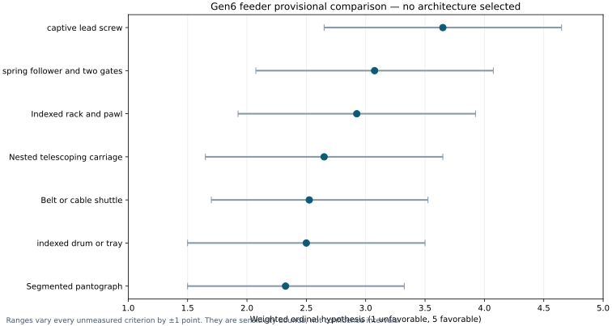

# Gen6 feeder alternatives: provisional weighted screen

**Status: active research alternatives; no feeder architecture selected or rejected.** This laboratory record preserves seven concepts while same-boundary geometry and fault evidence are collected. It does not release any part for construction.

The reference mission stores two passive 1U and two passive 3U spacecraft in independently retained cells and transfers one payload at a time into a common launch carrier. A cell fault must stay contained. Other cells may proceed only after a verified safe-path check. A power loss during transfer must not leave a free spacecraft.

The preliminary weights are fault containment/safety 35%, fit and installed mass 25%, positioning 20%, cycle time and power 10%, and manufacturability 10%. Scores of 1–5 are *engineering hypotheses*, not measured component properties. The [CSV](GEN6_FEEDER_TRADE_INPUTS.csv) records each criterion. Varying every unmeasured score by one point gives overlapping intervals for the leading candidates:

| Candidate | Weighted hypothesis / 5 | ±1 score interval / 5 |
|:--|--:|:--|
| Fixed-cell captive lead screw | 3.650 | 2.650–4.650 |
| Fixed-cell spring follower and two gates | 3.075 | 2.075–4.075 |
| Indexed rack and pawl | 2.925 | 1.925–3.925 |
| Nested telescoping carriage | 2.650 | 1.650–3.650 |
| Belt or cable shuttle | 2.525 | 1.700–3.525 |
| Geneva indexed drum or tray | 2.500 | 1.500–3.500 |
| Segmented pantograph | 2.325 | 1.500–3.325 |

The [qualitative concept record](GEN6_FEEDER_CONCEPT_TRADE.md) supplies operating principles and failure concerns. A separate two-layout four-cell FreeCAD/STEP screen in the main project now places two 1U and two 3U proxies in paired or staggered fixed cells. Pairing removes the staggered layout's short ideal acceleration path, but it does not select a transfer mechanism. The lead screw is an analysis reference because positive, reversible transfer and accessible stops are plausible. Spring/two-gate remains a runner-up, and the pantograph remains a packaging challenger. No concept passes a power-off restraint, full motion, loaded clearance, mechanism-level four-cell integration or installed-BOM gate. The numerical rank alone cannot determine a baseline.

Selection requires comparable four-cell editable CAD/STEP, swept and tolerance checks, sourceable actuator and lock parts, mass/CG/inertia, contact and load calculations, and a demonstrated safe fault response. Rejected concepts can be dispositioned here only after those checks. Until then they remain available for design exploration.
