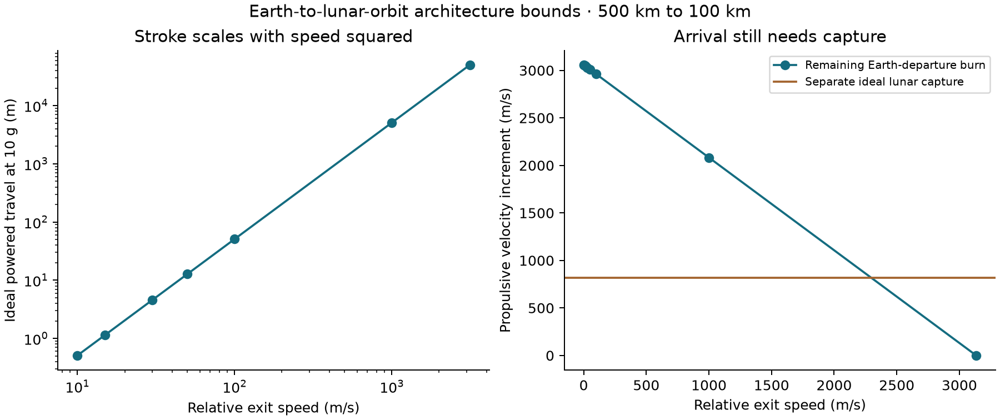

# Earth-to-lunar-orbit architecture bounds

500 km Earth parking orbit → 100 km circular lunar orbit. The first analytical screen calculates **3058.20 m/s Earth departure**, **820.31 m/s lunar capture**, and **4.984 days** ideal transfer. A separately integrated Earth two-body leg checks the endpoint; it is not a three-body encounter solution.

[Results](RESULTS.json) · [Cases](CASES.csv) · [Independent check](CHECKS.json) · [Figure](lunar_architecture_bounds.png)

The figure is an analytical scenario, not a simulated high-speed VOLLEY launcher. Departure is a coplanar tangential two-body transfer to the Moon's mean orbital radius. Arrival uses patched-conic relative speed and an impulsive lunar capture. It omits launch-window geometry, SSO plane matching, lunar phase, solar/three-body perturbations, finite burns and navigation error. Constants are explicit standard reference approximations, not epoch-specific ephemerides.

## Architecture interpretation

- **Carrier plus conventional deployment:** propulsion supplies departure and capture; conventional separation is small at this scale. This remains the comparison reference, not a disparaged alternative.
- **Carrier plus commanded release:** an achievable relative release contributes a finite-host-adjusted increment. The current 1–3 m/s cases provide small delivery-state corrections, not replacement of the kilometre-per-second transfer. Higher-speed rows are requirement scenarios.
- **Rail-dominant departure:** the existing full sled/pallet kept on the departing 4 kg payload would require approximately3134.40m/s relative exit. The larger outbound mass, recoil, launcher length and capture propulsion must be counted. This is a different spacecraft interface; the current rail has not achieved this condition.

A 4 kg payload alone needs about18.71MJ at3058.20m/s, excluding carrier hardware and losses. Under the declared full-sled flyaway masses the ideal rail work is much larger. Even ideal constant10g acceleration to3134.40m/s needs about50.09km powered travel. No finite-motor map is extrapolated over that distance. These are screening bounds, not a design or a universal impossibility proof.

Lunar capture remains820.31m/s in this fixed-arrival comparison. A genuinely optimized low-energy trajectory can change that requirement and time of flight, but requires a different complete trajectory solution. Reaching lunar distance is not equivalent to entering lunar orbit.

## Next engineering decision

Retain precise carrier-assisted release as the near-term architecture. Compare reusable extended-brake and attached-shoe candidates at attainable speeds before selecting a high-speed revision. A rail-dominant lunar system requires a fundamentally different installation or acceleration architecture; no best achievable speed 'in general' exists independently of its mass, power, length and load constraints.

The resource screen does not close the installed-system trade: actual propulsion-module/launcher masses, efficiencies, supplier interfaces and3D optimized trajectories remain required. No arbitrary battery energy density or unselected propulsion module is counted as actual hardware.

Rebuild using Python3, NumPy, SciPy and Matplotlib: `python study.py`. `python check_capture.py` checks published identities and key independent arithmetic.
