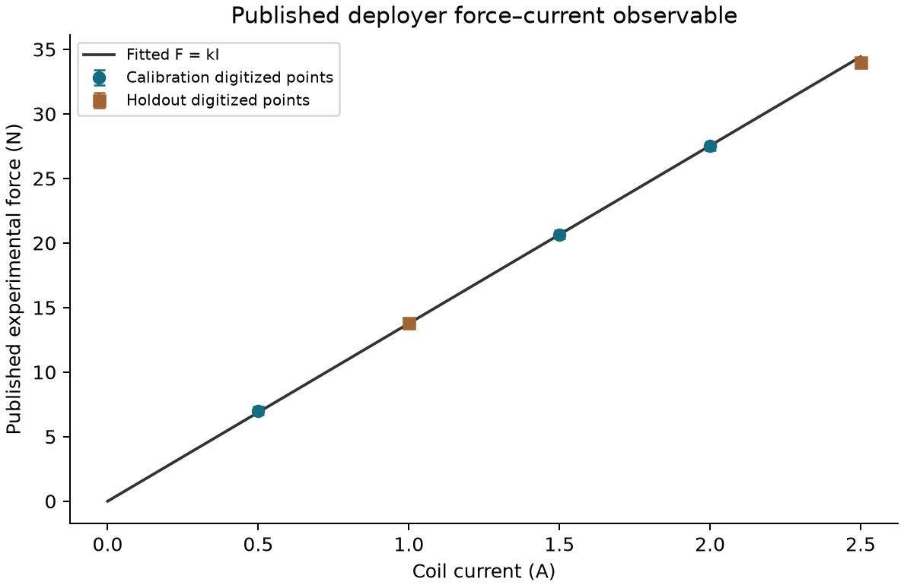

# Published electromagnetic-deployer force benchmark

Five experimental force/current points were digitized from Zhao et al., *Remote Sensing*14(2022),4205, Figure19a, p14; DOI[10.3390/rs14174205](https://doi.org/10.3390/rs14174205). The public publisher PDF was fetched and matched the previously captured SHA256. The full publisher PDF is not redistributed here.

[Digitized data](DIGITIZED_POINTS.csv) · [Extraction and fit](RESULTS.json) · [Source](analyze.py)

A zero-intercept **F=kI** fit uses0.5/1.5/2.0A calibration points;1.0/2.5A are held out. The fitted coefficient is13.7692N/A and the largest held-out residual is0.4231N. A two-pixel reading allocation corresponds to±0.3333N and±0.0168A; it excludes the original experiment's instrument/systematic uncertainty. This is an observable reconstruction with explicitly fitted gain, not a first-principles reproduction or independent hardware validation.

## Traceable extraction

Render PDF page14 with Poppler at1600pixels along the long edge. Axis endpoints are(218,578)→(516,338), corresponding to0–2.5A and0–40N. Locate red experimental markers inside the documented local windows, select red pixels(R>170,G<135,B<150) and use their median vertical coordinate. Pixel centres, conversion, data roles and source SHA are preserved in RESULTS.json. `analyze.py` reproduces the numerical fit and figure from those recorded coordinates. Manual window placement and plotted-data resolution are limitations.

The source's equation14 motivates the force-current form; its gap field, conductor coverage, turns and geometry are not independently solved by fittingk. The source also discusses armature-reaction/end effects. Recovering sufficient dimensions/materials and reconstructing the published field/force geometry remains required before transferring a model-discrepancy allowance to VOLLEY. No13.7692N/A constant is substituted into VOLLEY's finite Halbach motor, and no low-current laboratory result substantiates a600A or high-speed rating.

Python3, NumPy and Matplotlib regenerate the figure. `python check_capture.py` checks identities and held-out arithmetic.
