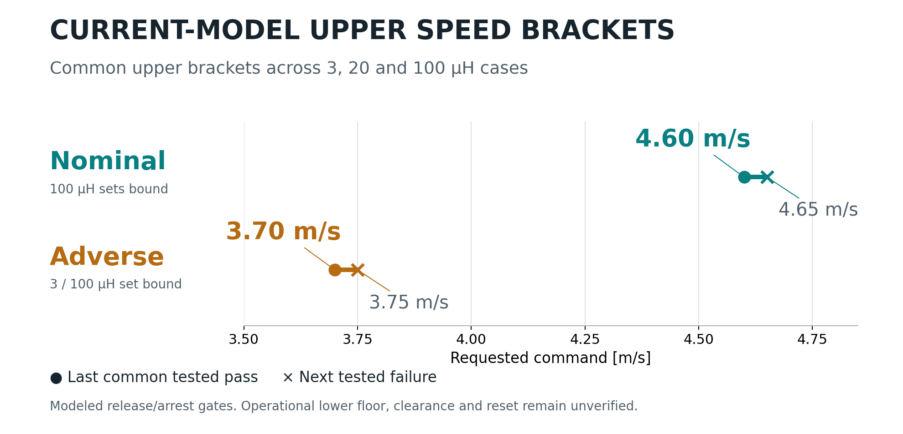
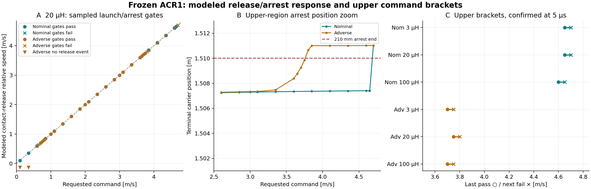

# Sampled speed and architecture requirements

<!-- SIMPLE_HERO -->

| Source condition | Common tested upper pass | Next limiting failure | Limiting sensitivity |
|---|---:|---:|---|
| Nominal | **4.60 m/s** | 4.65 m/s | 100 µH |
| Adverse | **3.70 m/s** | 3.75 m/s | 3 / 100 µH |

These are sampled modeled launch/arrest gates. Current published command points remain 1, 2 and 3 m/s; operational lower speed, full clearance and powered reset are unverified.

[Editable SVG](ENVELOPE_HERO.svg) · [PDF](ENVELOPE_HERO.pdf)
<!-- END_SIMPLE_HERO -->

This bounded study evaluates the unchanged pinned ACR1 averaged source model. It contains **106 unique records: 88 newly computed cases and 18 accepted-case reuses**. The specified 0.1–4.7 m/s coarse scan uses 0.25 m/s increments plus exact 1/2/3 command points and the 4.7 endpoint, nominal/adverse at 20 µH/20 µs. Observed transitions are resolved at 0.05 m/s, with targeted 3/100 µH upper-bracket bisections and **17 5 µs checks**. Only two upper-edge histories are retained. No source, voltage, current, control or acceptance limit was changed or optimized.

Detailed three-panel evidence and architecture requirements

[Editable detailed plot](SAMPLED_ENVELOPE.svg) · [Geometry and inventory requirements](GEOMETRY_AND_INVENTORY.svg)

## What the sampled gates say

At **20 µH**, nominal sampled commands pass the source model's launch/arrest checks from **0.10 through 4.65 m/s**; 4.70 fails arrest. Adverse sampled commands pass from **0.70 through 3.75 m/s**; 0.65 fails the release-speed tolerance and 3.80 fails the arrest-position gate. The 5 µs checks retain those pass/fail results. These are sampled computational results; interpolation between commands is not experimentally validated.

| Condition | L (µH) | Last sampled upper pass | Next sampled fail |
|---|---:|---:|---:|
|Nominal|3|4.65 m/s|4.70 m/s|
|Nominal|20|4.65 m/s|4.70 m/s|
|Nominal|100|4.60 m/s|4.65 m/s|
|Adverse|3|3.70 m/s|3.75 m/s|
|Adverse|20|3.75 m/s|3.80 m/s|
|Adverse|100|3.70 m/s|3.75 m/s|

Inductance sensitivity matters: the adverse 20 µH upper value must not be transferred to 3/100 µH. Their upper sampled pass is 3.70 m/s, with 3.75 failing. The common upper sampled commands are **4.60 m/s nominal and 3.70 m/s adverse**, each explicitly checked at 5 µs at all three inductances. The complete lower-speed scan was performed only at 20 µH; 3/100 µH share the original 1/2/3 evidence plus targeted upper samples. No continuous all-inductance interval is established.

`STOPPED` in the inherited code means the **first low-speed turnaround**. It does not simulate powered return/reset, full payload exit clearance, contact/interlock proof, custody completion or a safe feeder cycle. A STOPPED case can still exceed the allowed position: the adverse 3.80 m/s result illustrates this. SAMPLED_CASES exposes the source status and every failed gate separately.

The requested command is separate from the modeled rear-contact release speed and payload inertial kick. The model's release event is not a verified complete payload exit. Its cam-open check is a position proxy, not a fresh geometry/interlock demonstration. The **operational lower-speed floor is unset**: low-speed clearance, stiction/contact uncertainty, timing and interlocks are not established by a kinetic-model pass. Current published ACR1 command points remain **1, 2 and 3 m/s**; this study supplies additional research evidence, not a hardware rating.

The averaged source calculation retains its fixed nominal/adverse resistance and component allocations. It does not establish new repeated-duty winding/source temperatures, structural/tolerance life, six-degree-of-freedom contact/exit behavior or EMC acceptance at the additional commands. Those broader gates remain necessary before any operational or article-speed extension.

## Numerical checks

All 17 coarse/fine decisions agree. Maximum 20→5 µs contact-release speed change is 6.750446e-05 m/s; terminal-position change is 0.012378 mm. Independent reduced-mass kinetic work plus friction agrees with signed motor work to 1.8e-11 J. Original declared total-energy and component gates are retained as returned by the model; failed cases stay visible. Source and input hashes match the sibling accepted capture.

## Separate architecture requirements

The analytical sweep covers 1.3/2.5/5/10 m drive and retained-sled arrest lengths, 5/10/25 g **relative-motion** caps, and 10/15/30/50/100 m/s targets. GEOMETRY_REQUIREMENTS contains 80 variant/speed/length rows; RANKED_REQUIREMENTS contains 60 variant/speed/g rows. Passing a kinematic distance condition does not establish force, source, thermal, structural or payload acceptance. No current force map is transferred to any changed geometry.

Every mass variant is explicit. The common nonmoving allocation is 143.428914 kg, including the current 7 kg power/control allowance once; the notional bus is 500 kg wet and the manifest remains 12×4 kg. A reusable current carrier occurs once; flyaway adapters occur twelve times. First-event reduced masses and host inventory are recomputed from those assumptions, with no claimed 12-release simulation.

| Variant | Adapter mass | Number carried | Adapter inventory | Initial combined mass |
|---|---:|---:|---:|---:|
|RETAINED_CURRENT|13.127806 kg|1|13.127806 kg|704.556720 kg|
|FLYAWAY_MAGNET_FLOOR|3.628800 kg|12|43.545600 kg|734.974514 kg|
|FLYAWAY_MAGNET_PLUS_1KG|4.628800 kg|12|55.545600 kg|746.974514 kg|
|FLYAWAY_FULL_SLED|13.127806 kg|12|157.533669 kg|848.962583 kg|

The 3.6288 kg floor comprises 84 current moving magnets only. It has no guide, support or attachment allowance and is not a buildable shoe. The magnet-plus-1 kg variant has a fully stated mass allocation, but its 1 kg structural/retention allowance is unsubstantiated. Full-sled flyaway removes successful-departure arrest but retains the same moving mass and requires twelve complete members. Its release dynamics, payload interface and mass budget are a different architecture. Attached adapters are not credited as free debris; partial-launch and stuck-payload containment remain required.

Individual moving-mass energy savings can coexist with a larger total adapter inventory. Even the magnet-only flyaway floor carries 43.5456 kg of magnets over twelve payloads versus one current 13.1278 kg moving carrier. A 0.25/0.5/1 kg shoe cannot retain the present magnet set and needs a different electromagnetic topology. Complete installed mass, payload magnetic acceptance and mission advantage remain unproved.

## What remains pending

Ten metres per second is the first new design target; fifteen follows before 30+. The two candidate records R10 (2.5 m drive/1.3 m retained arrest) and F10 (2.5 m drive, attached magnet-plus-1 kg shoe) are **pending coupled work**, not completed designs. Their dimensions are requirement hypotheses. New finite fields, resistance/inductance, source/braking or exit control, actual structural mass, geometry/custody, thermal and payload/host interfaces are required. This deliverable stops at the verified frozen-model scan and analytical requirements; it does not replace those missing studies with extrapolated force curves.

## Reproduce

Run `python3 run_envelope.py`, `MPLCONFIGDIR=/tmp/volley-env-mpl python3 analyze.py`, then `python3 check_capture.py`. The driver caches exact parameter cases and reuses matching accepted records. The immutable source is `../higher-speed-envelope/capture/analysis/coupled_shot.py`; SOURCE_PINS records its exact identity and input hashes.
