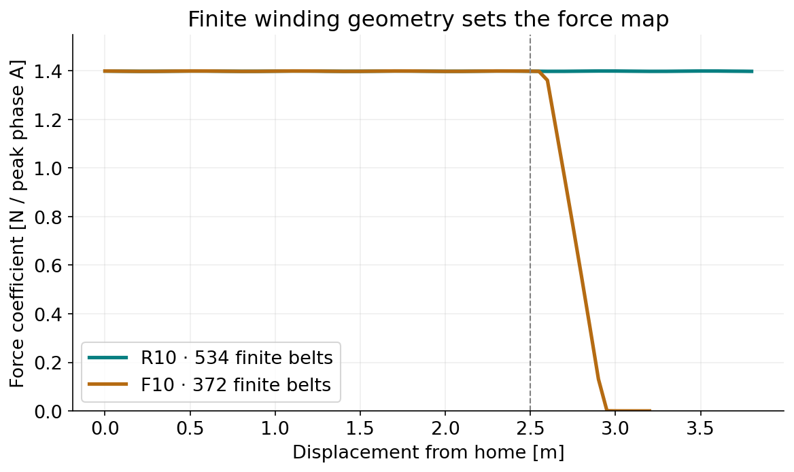
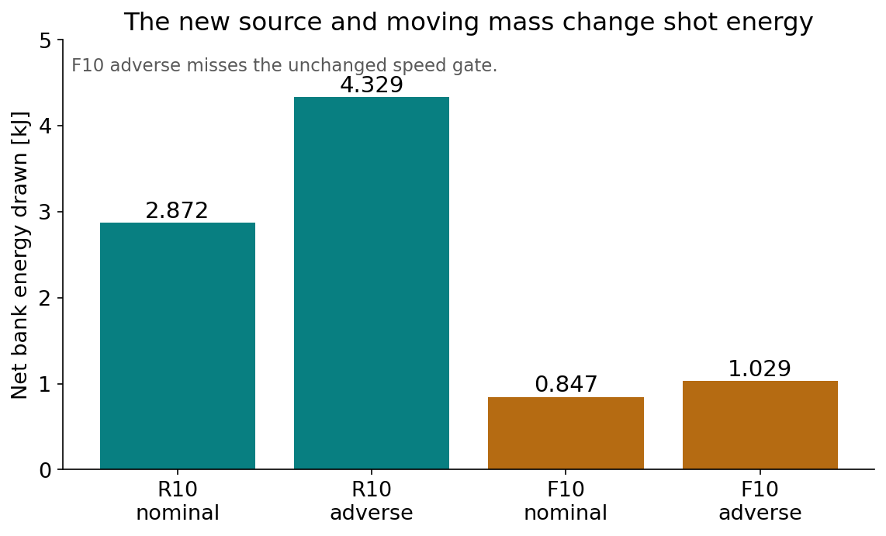
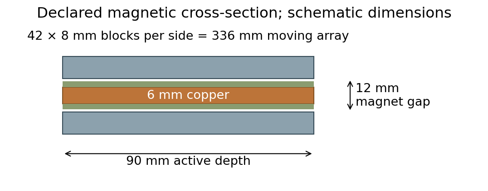

# R10 and F10: actual ten-metre-per-second design computations

Two new finite windings and explicit mass/source configurations were computed. These are one-shot averaged circuit/motion design computations. The accepted ACR1 command points remain 1, 2 and 3 m/s.

| Case, 5 µs | Relative departure | Source draw | Declared circuit/motion gates |
|---|---:|---:|---|
|R10-R1 nominal|10.000777 m/s|2871.95 J|pass|
|R10-R1 adverse|9.995642 m/s|4328.95 J|pass|
|F10-R1 nominal|10.004228 m/s|846.95 J|pass|
|F10-R1 adverse|9.993107 m/s|1028.77 J|FAIL: speed|

## New geometry and components

R10 uses 534 finite belts, 2.5 m powered travel and 1.3 m active arrest. Home aft is 200 mm, release 2700 mm, arrest 4000 mm; the new 4750 mm rail allows the reused carrier envelope plus margin. The declared cam opens over 2645–2695 mm and holds through 4000 mm. F10 uses 372 finite belts, 2.5 m powered travel and a 3400 mm guide exit plane; its attached 430 mm shoe/payload clears when its aft reference reaches that plane.

The 84 moving magnet blocks retain the source geometry and 3.6288 kg computed mass. F10 adds 1 kg allocated GFRP/aluminum support, fasteners, retention and liners to each modified payload; all 12 shoes are carried. This allocation is not a substantiated structural design or verified fit in the legacy storage/feeder. R10 reuses the 13.127806 kg carrier once. Old track/stator/support/cam masses are removed and replaced by explicitly dimensioned copper, rail, backbone, plate, crossmember and cam quantities in the mass ledgers. CAD-derived, computed-volume and allocated masses are identified.

**R10:** device initial dry 179.527060 kg; loaded initial host+device+48 kg payload 727.527060 kg. Copper 25.870307 kg; phase 20°C resistances 18.067, 18.067, 16.810 mΩ. Refined balanced partial-element inductance 10.887–11.135 µH. Source 32 S6 P, 192 original Eaton reference cells, 3.84 kg bare.

**F10:** device initial dry 203.217330 kg; loaded initial host+device+48 kg payload 751.217330 kg. Copper 18.107578 kg; phase 20°C resistances 12.734, 12.734, 11.783 mΩ. Refined balanced partial-element inductance 7.619–7.872 µH. Source 32 S2 P, 64 original Eaton reference cells, 1.28 kg bare.

Charge remains 86.4 V. The original 600 A mean phase, 92 A hot-device and 200 V switch gates are unchanged. R10 adds parallel cells; it does not raise cell voltage or individual-device ratings. The same three-half-bridge/ten-parallel-device topology and original loss/parasitic assumptions are retained. Resistance comes from actual new finite conductor segment lengths/sections and temperature-dependent copper, with an explicit 2 mΩ joint allowance. Balanced L is computed from the declared new phase paths at 20/10 mm panels; it is a partial-element estimate, not full AC/FEM characterization.

## What changed in physics and control

Finite Lorentz integration uses the actual new belt positions, 84 cuboids, active copper volumes and return geometry. No old k(x) is tiled or stretched, and no external actuator force fit is transferred. Force integration covers active winding and internal returns; terminal lead paths enter R/L estimates, while their motional force and AC-support interaction remain outside the field model. The primary return cross-section quadrature is 1 point per transverse axis; the refined map uses 3, plus additional 0.05 m handoff/exit stations. Independently higher-order 5×5×9 active/7-point return anchor checks are retained. Exact finite-source query caching identifies only equal physical coordinates (1 pm quantization); it does not impose periodic source fields.

R10 includes finite host reaction, payload detachment at zero rear normal reaction, active current-limited arrest and magnetic energy. STOPPED is first low-speed turnaround, not powered return/reset. F10 carries payload and shoe together through a declared open guide and source-current decay, with explicit friction feed-forward for the passive exit coast. The controller uses allocated case friction; an actual friction estimator is not demonstrated. The adverse R1 speed miss is preserved. No R2 tuning or 11–13 m/s upper-speed result is claimed.

## Refinement and conservation

R10-R1 nominal: refined map departure 10.000777 m/s, change-0.0000004 m/s; model gatespass.

R10-R1 adverse: refined map departure 9.995492 m/s, change-0.0001501 m/s; model gatespass.

F10-R1 nominal: refined map departure 10.004231 m/s, change+0.0000028 m/s; model gatespass.

F10-R1 adverse: refined map departure 9.992913 m/s, change-0.0001932 m/s; model gatesFAIL speed.

Four 20→5 µs motion pairs and actual refined-field reruns are archived. Independent reduced-mass kinetic work+friction agrees with signed motor work to 3.03 e-10 J; maximum complete electrical energy residual is 0.0896 J. Source draw, all losses, remaining magnetic energy and failure gates are retained. Numerical agreement is not measured accuracy.

## One-shot thermal and practical decision

R10-R1 nominal: copper adiabatic rise 0.1859 K from its allocated 50/100°C initial state; inverter loss 487.62 J; bank ESR rise spans 0.0216, 0.0371 K for the explicitly assumed 700–1200 J/kg/K cell heat capacity.

R10-R1 adverse: copper adiabatic rise 0.2783 K from its allocated 50/100°C initial state; inverter loss 528.31 J; bank ESR rise spans 0.1144, 0.1961 K for the explicitly assumed 700–1200 J/kg/K cell heat capacity.

F10-R1 nominal: copper adiabatic rise 0.0255 K from its allocated 50/100°C initial state; inverter loss 135.06 J; bank ESR rise spans 0.0245, 0.0420 K for the explicitly assumed 700–1200 J/kg/K cell heat capacity.

F10-R1 adverse: copper adiabatic rise 0.0368 K from its allocated 50/100°C initial state; inverter loss 133.16 J; bank ESR rise spans 0.0790, 0.1354 K for the explicitly assumed 700–1200 J/kg/K cell heat capacity.

The winding loss heats its computed copper mass and feeds resistance back during the shot. Cell heat capacity is an assumption, not catalog data. Inverter transient junction temperature, actual case/sink temperatures, insulation/material limits, skin/proximity/eddy losses, repeated duty and TVAC acceptance remain unresolved. The small calculated bulk rises do not qualify the circuit.

R10 is the stronger present computational candidate: it passes the enumerated 10 m/s model gates with the longer arrest and larger bank. F10 reduces one-shot energy but carries 12 attached adapters and requires new payload/storage/exit/abort interfaces; its adverse R1 speed miss remains outside the original±0.005 m/s gate. Neither case closes new CAD clearances, structural strength, fault containment, EMC, payload magnetic compatibility, return/reset, or physical/source qualification.

## Reproduce

Run `build_design.py` with Magpylib 5.2.3/NumPy 2.4.6;`configure_mass.py`;`run_cases.py`;`refine_maps.py`;`finish_report.py`; then `check_capture.py`. The refinement uses two CPU processes. The neutral SVGs retain editable text; PDF uses Type 42 fonts. `provenance/` contains byte-identical original sources and inputs;`COUPLED_SOURCE_CHANGE.diff` exposes the new integration. All paths resolve relative to this folder. No third-party binary or PDF is redistributed.
