# Seven feeder concepts

Seven preserved four-payload concepts are shown with the same orthographic direction, role colours and 2.013 m × 1.510 m field. Each model is centered on its projected geometry; every scale bar is 500 mm in the image plane. All native parts are retained in those full source views. Expand a drive detail to inspect the actual represented mechanism in its original position; its individual scale is printed. Blue solids are payload proxies and pale blocks are unselected actuator/sensor envelopes.

The displayed geometry is **FDR09-R1 historical concept geometry** for two 1U and two 3U surrogates. Roles and ranks come from the later [FDR10-R0 / D27-R2 architecture decision](../../experiments/selected_feeder/verification/REPORT.md). The selected guided lead-screw architecture was developed in FM08-R3; the current twelve-3U ACR1 assembly retains its own identity.

[Open responsive local gallery](../../docs/feeder-concepts.html) · [Full comparison plate](seven_feeder_concepts.png) · [Print plate](seven_feeder_concepts.pdf) · [Source and hash manifest](MANIFEST.json)

## 1. Guided lead screw · Selected architecture lineage

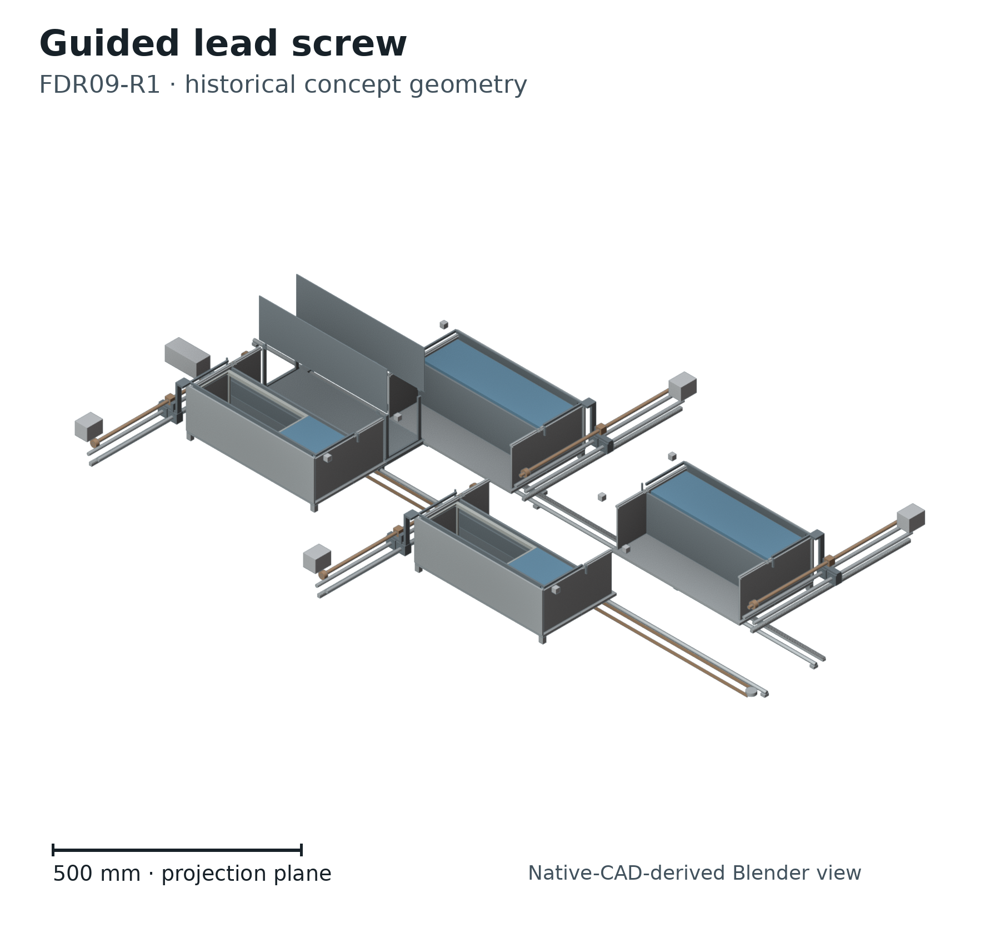

A guided screw and nut drive a reversible lateral pusher. Selected for controllability and available corrected geometry/sizing evidence; the detailed selected study is FM08-R3.

Source-derived drive detail

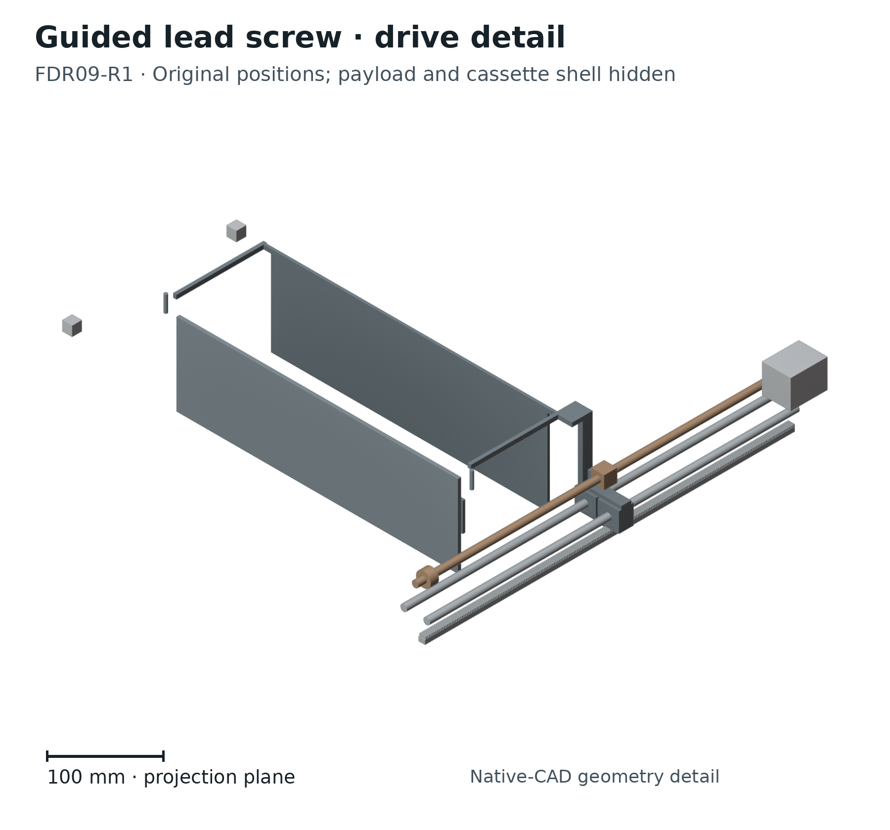

B_3U drive, pusher, guide and retention parts; payload and cassette shell omitted for access. Image-plane scale: 100 mm. The [view provenance](RENDER_PROVENANCE.json) lists every displayed and omitted source object.

**Display:** FDR09-R1, stowed four-payload concept. **Trade:** FDR10-R0 weighted judgment 7.30/10. [Native CAD](../../experiments/feeder_common_boundary/release/lead_screw_four_carrier_stowed_R1.FCStd) · [STEP](../../experiments/feeder_common_boundary/release/lead_screw_four_carrier_stowed_R1.step) · [Trade source](../../experiments/selected_feeder/verification/REPORT.md)

## 2. Rack and pawl · Runner-up

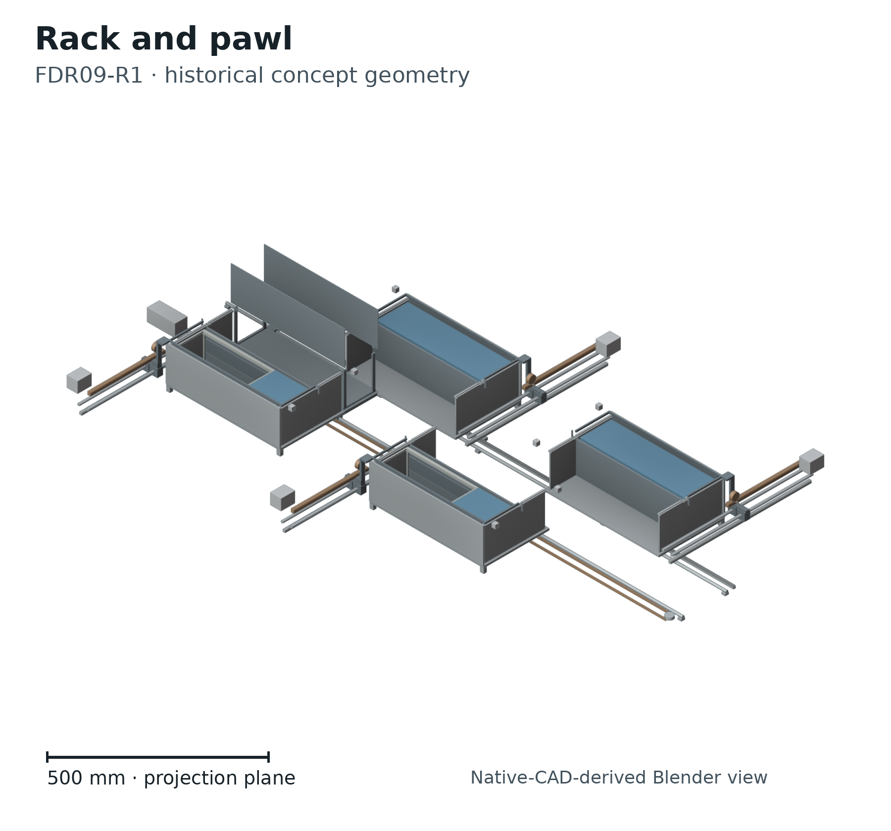

A toothed drive advances the pusher; a pawl provides retention/indexing. Positive engagement is the runner-up. Tooth/root support, backlash and skipped engagement remain engineering costs.

Source-derived drive detail

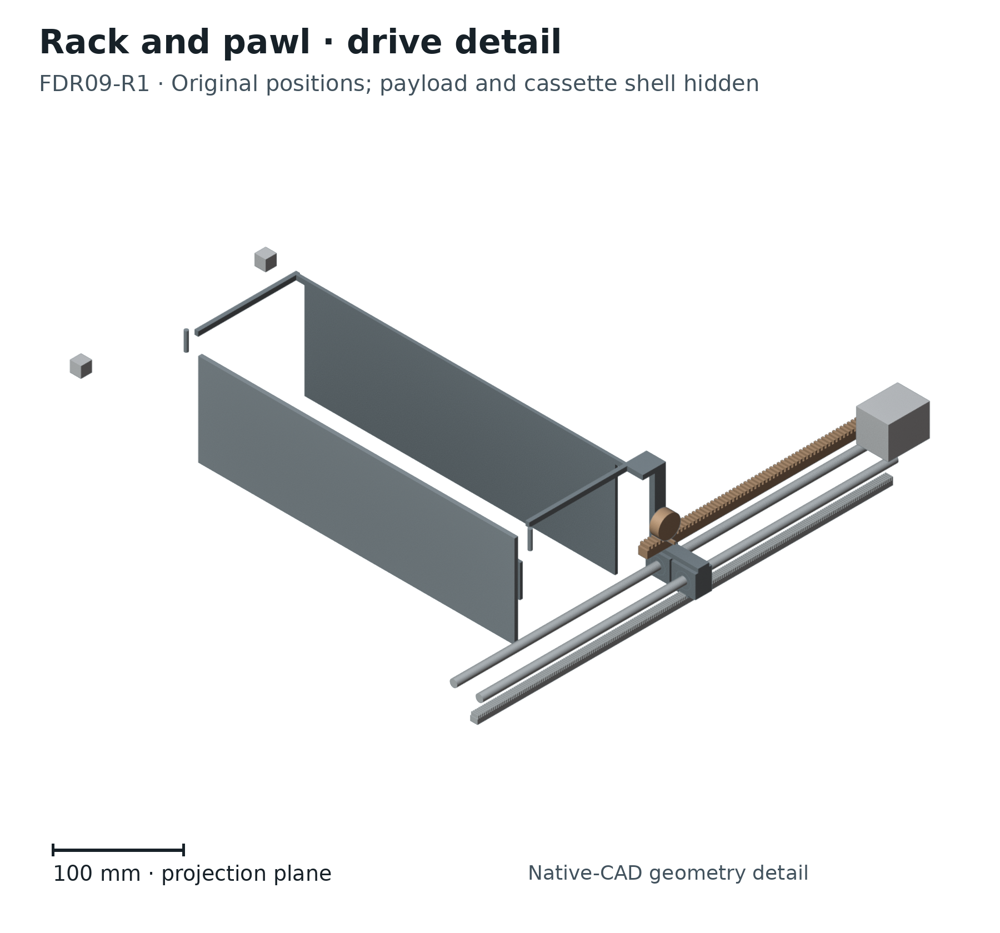

B_3U drive, pusher, guide and retention parts; payload and cassette shell omitted for access. Image-plane scale: 100 mm. The [view provenance](RENDER_PROVENANCE.json) lists every displayed and omitted source object.

**Display:** FDR09-R1, stowed four-payload concept. **Trade:** FDR10-R0 weighted judgment 7.10/10. [Native CAD](../../experiments/feeder_common_boundary/release/rack_pawl_four_carrier_stowed_R1.FCStd) · [STEP](../../experiments/feeder_common_boundary/release/rack_pawl_four_carrier_stowed_R1.step) · [Trade source](../../experiments/selected_feeder/verification/REPORT.md)

## 3. Spring and two gates · Retained alternative

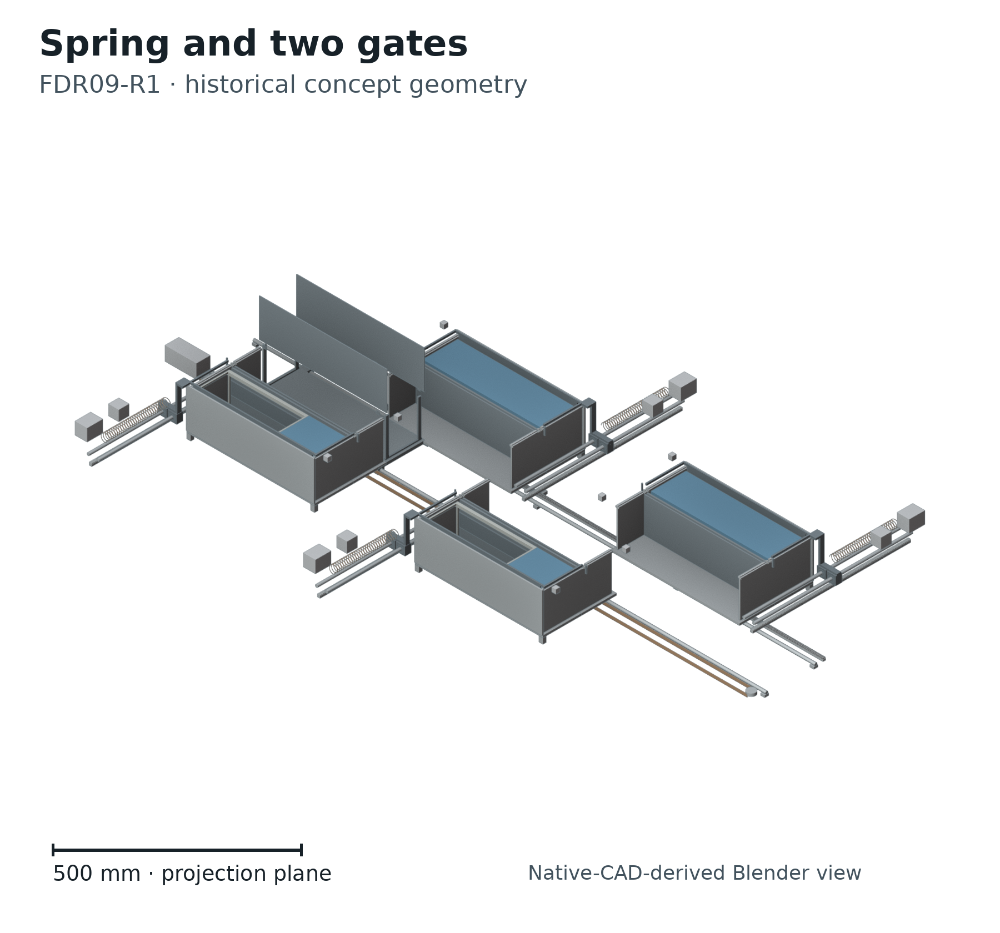

Stored spring energy feeds the payload through a two-gate sequence. Low powered-feed demand; the historical 15 N end-force assumption needs spring/governor redesign for the declared feed demand.

Source-derived drive detail

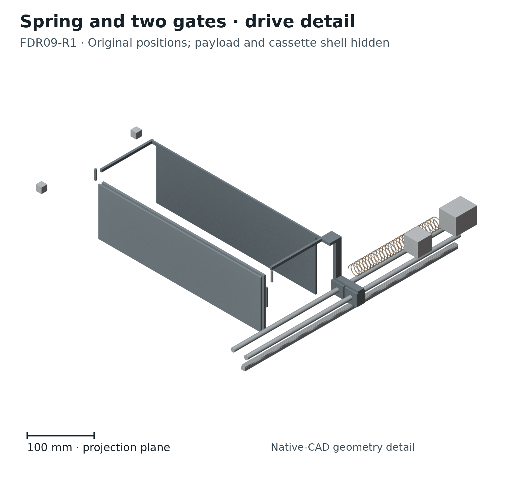

B_3U drive, pusher, guide and retention parts; payload and cassette shell omitted for access. Image-plane scale: 100 mm. The [view provenance](RENDER_PROVENANCE.json) lists every displayed and omitted source object.

**Display:** FDR09-R1, stowed four-payload concept. **Trade:** FDR10-R0 weighted judgment 6.90/10. [Native CAD](../../experiments/feeder_common_boundary/release/spring_dual_gate_four_carrier_stowed_R1.FCStd) · [STEP](../../experiments/feeder_common_boundary/release/spring_dual_gate_four_carrier_stowed_R1.step) · [Trade source](../../experiments/selected_feeder/verification/REPORT.md)

## 4. Belt shuttle · Retained alternative

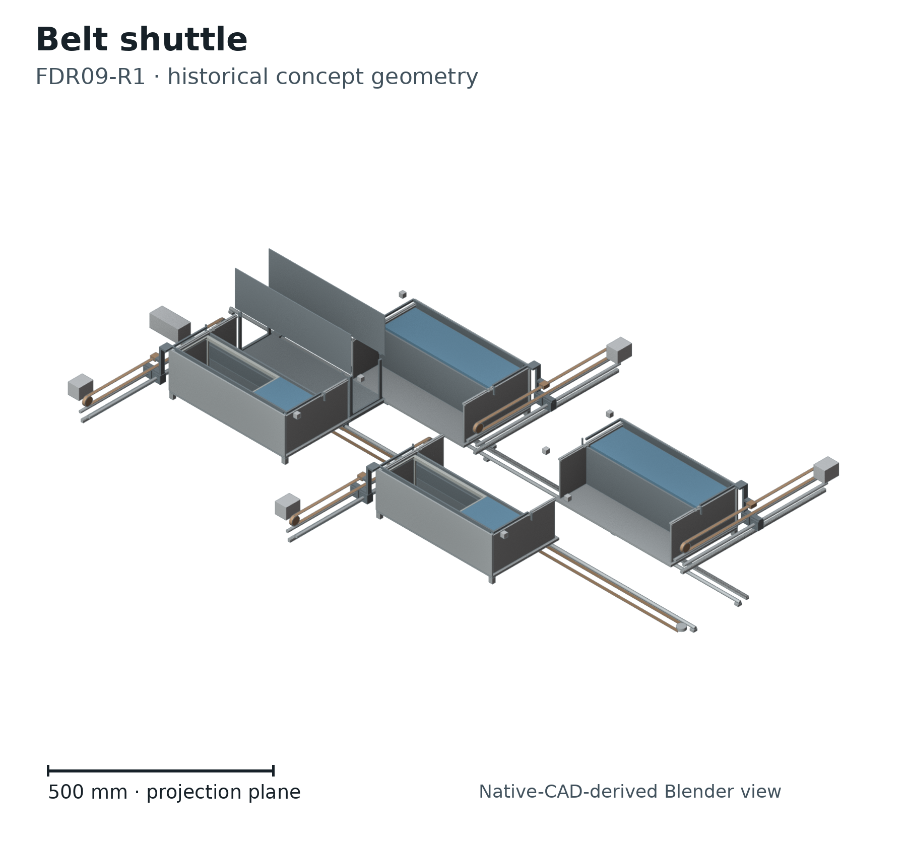

A tensioned belt moves the transfer shuttle along a guided path. Retained packaging alternative; tension, compliance, retention and skipped engagement require evidence.

Source-derived drive detail

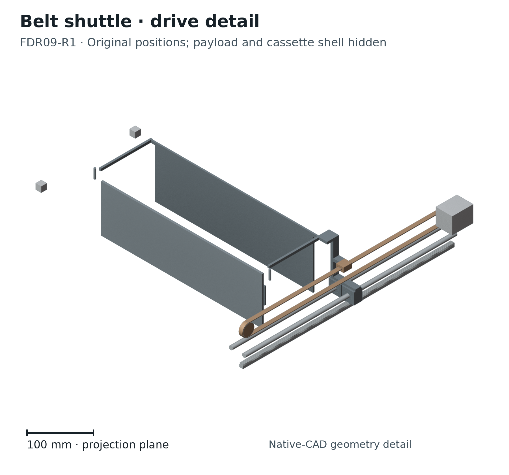

B_3U drive, pusher, guide and retention parts; payload and cassette shell omitted for access. Image-plane scale: 100 mm. The [view provenance](RENDER_PROVENANCE.json) lists every displayed and omitted source object.

**Display:** FDR09-R1, stowed four-payload concept. **Trade:** FDR10-R0 weighted judgment 6.70/10. [Native CAD](../../experiments/feeder_common_boundary/release/belt_shuttle_four_carrier_stowed_R1.FCStd) · [STEP](../../experiments/feeder_common_boundary/release/belt_shuttle_four_carrier_stowed_R1.step) · [Trade source](../../experiments/selected_feeder/verification/REPORT.md)

## 5. Indexed drum · Retained common-port concept

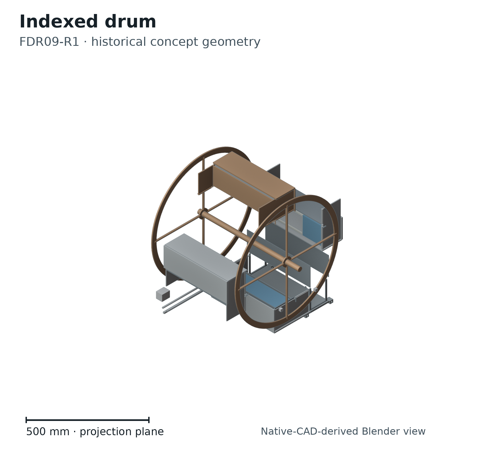

Four storage cells rotate toward one common extraction port. Common-port packaging is retained; the R1 extraction transmission and index connection remain undeveloped.

Source-derived drive detail

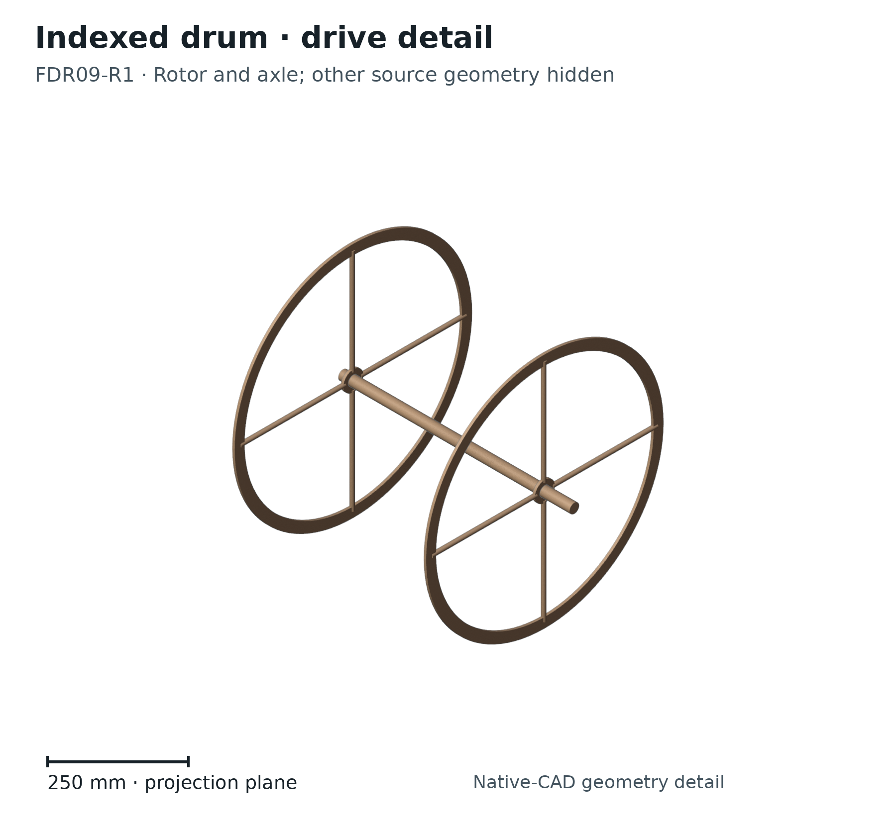

Drum rotor and axle only. Image-plane scale: 250 mm. The [view provenance](RENDER_PROVENANCE.json) lists every displayed and omitted source object.

**Display:** FDR09-R1, stowed four-payload concept. **Trade:** FDR10-R0 weighted judgment 6.40/10. [Native CAD](../../experiments/feeder_common_boundary/release/indexed_drum_four_carrier_stowed_R1.FCStd) · [STEP](../../experiments/feeder_common_boundary/release/indexed_drum_four_carrier_stowed_R1.step) · [Trade source](../../experiments/selected_feeder/verification/REPORT.md)

## 6. Telescopic carriage · Retained compact-stowage concept

Nested stages extend a guided transfer carriage from a short stowed package. Stage alignment, overlap, synchronization, stops and binding remain redesign requirements.

Source-derived drive detail

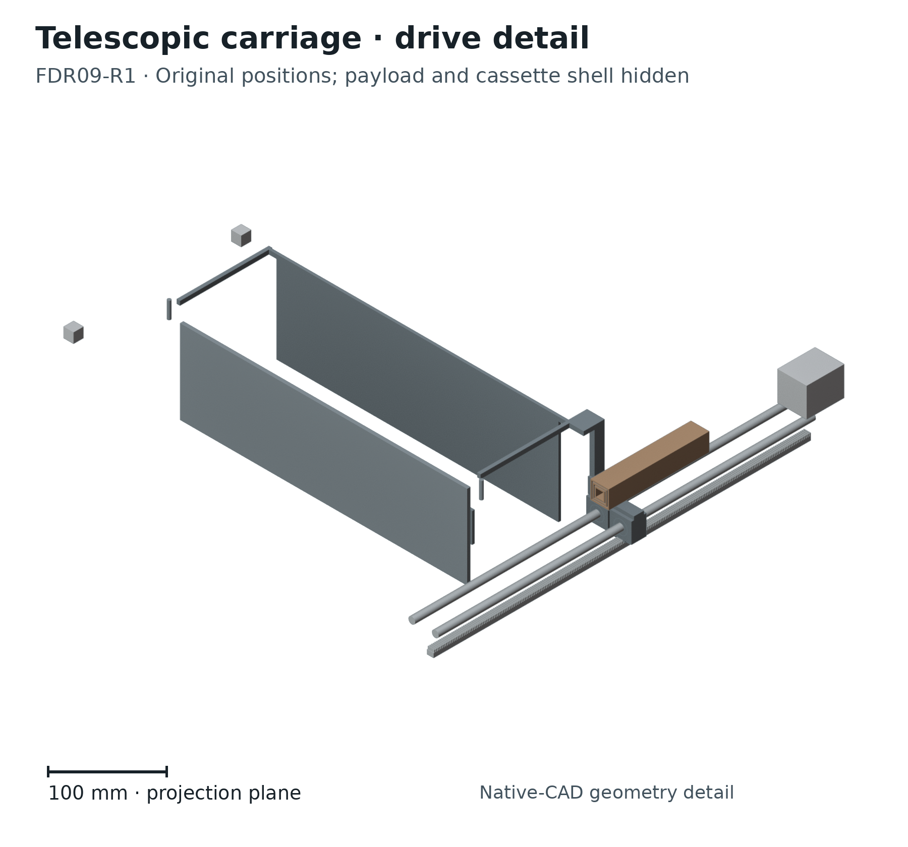

B_3U drive, pusher, guide and retention parts; payload and cassette shell omitted for access. Image-plane scale: 100 mm. The [view provenance](RENDER_PROVENANCE.json) lists every displayed and omitted source object.

**Display:** FDR09-R1, stowed four-payload concept. **Trade:** FDR10-R0 weighted judgment 6.05/10. [Native CAD](../../experiments/feeder_common_boundary/release/telescopic_four_carrier_stowed_R1.FCStd) · [STEP](../../experiments/feeder_common_boundary/release/telescopic_four_carrier_stowed_R1.step) · [Trade source](../../experiments/selected_feeder/verification/REPORT.md)

## 7. Pantograph · Retained linkage concept

A folding linkage converts a compact stowed form into transfer travel. Collapsible storage remains research work; linkage connections, near-flat loads and joint play require redesign.

Source-derived drive detail

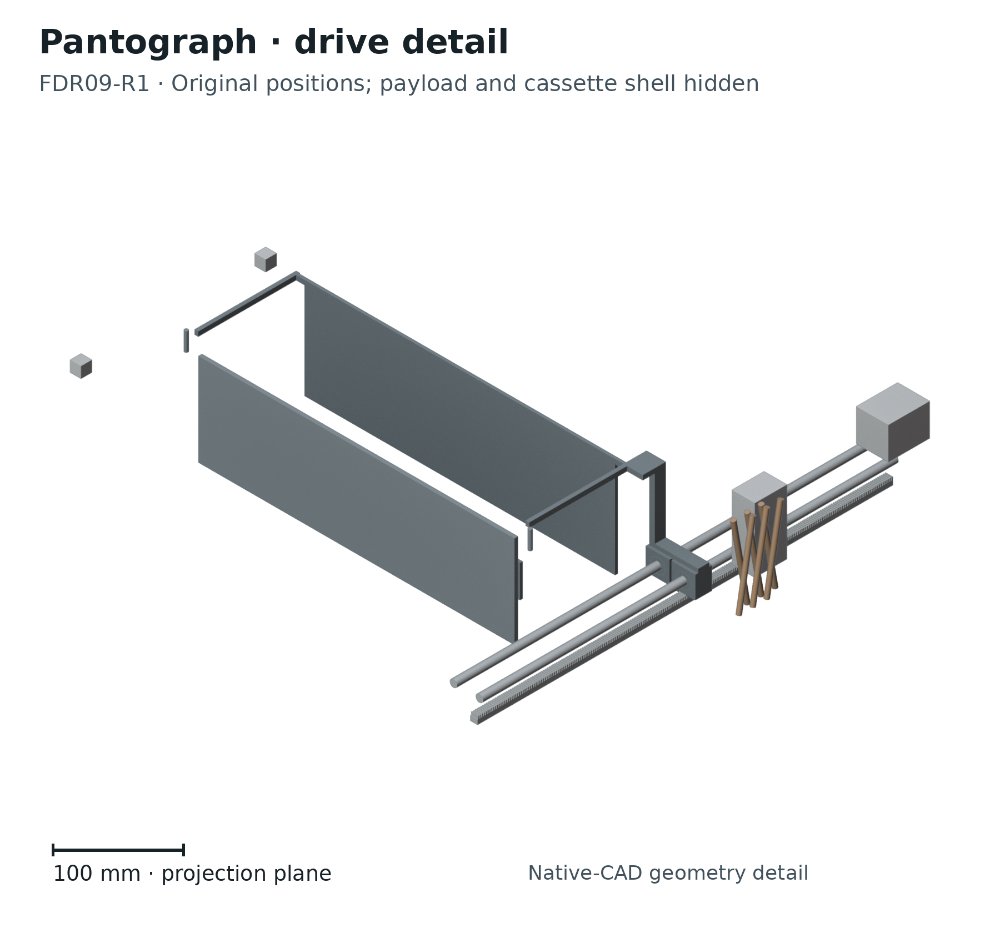

B_3U drive, pusher, guide and retention parts; payload and cassette shell omitted for access. Image-plane scale: 100 mm. The [view provenance](RENDER_PROVENANCE.json) lists every displayed and omitted source object.

**Display:** FDR09-R1, stowed four-payload concept. **Trade:** FDR10-R0 weighted judgment 5.50/10. [Native CAD](../../experiments/feeder_common_boundary/release/pantograph_four_carrier_stowed_R1.FCStd) · [STEP](../../experiments/feeder_common_boundary/release/pantograph_four_carrier_stowed_R1.step) · [Trade source](../../experiments/selected_feeder/verification/REPORT.md)

## Evidence and reproduction

Scores are declared engineering judgments, not measured reliability. The original [FDR09 gate outcomes](../../experiments/feeder_common_boundary/release/D27_GATES.json) and [comparison report](../../experiments/feeder_common_boundary/release/READ_ME.md) remain unchanged; the later architecture selection uses its own decision rule. These views depict the preserved historical concept geometry.

Regenerate visualization meshes with `PYTHONPATH=/usr/lib/freecad-python3/lib /usr/bin/python3 figures/feeder-concepts/export_meshes.py`. Run `blender -b -t 4 -P figures/feeder-concepts/render_concepts.py`, then `python3 figures/feeder-concepts/build_gallery.py`. The editable Blender scene contains all seven native-derived scenes. Run `python3 figures/feeder-concepts/package_scene.py` to create the lossless XZ publication package. Restore it with `xz --decompress --keep figures/feeder-concepts/FDR09_seven_concepts.blend.xz`; the decompressed identity is recorded in `SCENE_ARCHIVE.json`. Meshes are for display, not structural/contact analysis.

Project-created geometry, renders, plate and source: [CC BY 4.0](../../LICENSE), with attribution in [NOTICE](../../NOTICE). Font software is an installed rendering dependency and is not bundled. [Scientific figure conventions](../../docs/FIGURE_STANDARD.md).
